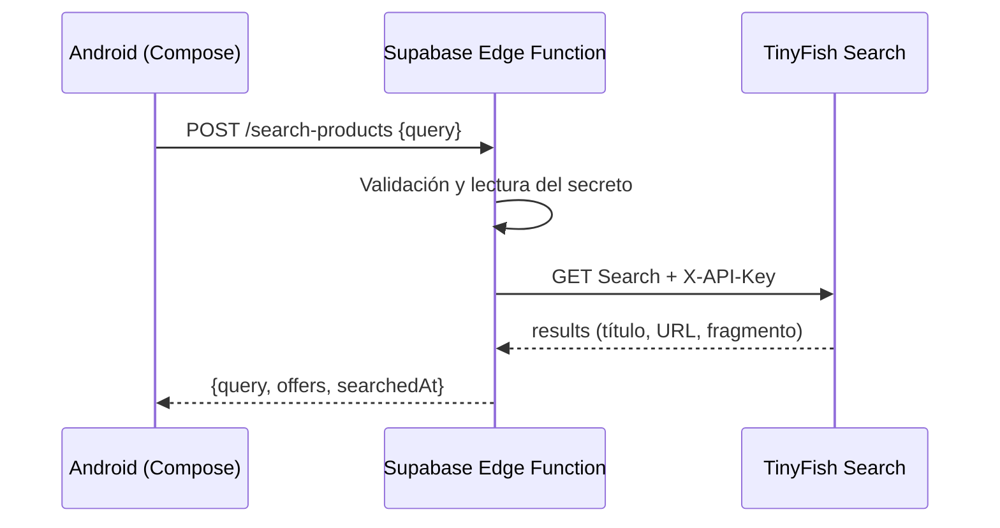

# TinyPrice · Android nativo + IA + Supabase

PEA: integración de un servicio IA mediante una Supabase Edge Function en una aplicación móvil nativa. Desarrollado sobre la plantilla creada por el usuario en Android Studio, siguiendo el [codelab TinyPrice](https://epanchanaf.github.io/tinyprice-codelab/).

## Funcionamiento

Android recibe una consulta y muestra carga, resultados, errores y el detalle de cada oferta. El repositorio demo permite comprobar la interfaz sin conexión a servicios. El repositorio remoto envía la consulta a `search-products` en Supabase; la función consulta TinyFish Search con una clave que permanece en el servidor.



TinyFish Search descubre fuentes y no garantiza precios normalizados. Los resultados remotos muestran **Ver en fuente** para que el usuario verifique la información en la tienda. La clave de TinyFish nunca debe estar en Kotlin, BuildConfig, un APK, logs o GitHub.

## Android Studio

Abre esta carpeta y sincroniza Gradle. Selecciona el módulo **app** y un teléfono o emulador Android 6.0/API 23 o superior. El paquete de la aplicación es `com.example.tinyprice_android_supabase`.

La configuración usa AGP 9.3.0 y Gradle 9.5.0 para ser compatible con el Android Studio instalado. Se conservan Kotlin 2.2.10, Compose BOM 2026.02.01 y SDK 37 del codelab. Se requiere JDK 17 o superior para Gradle. Esta adaptación evita el error del IDE que limita AGP a 9.3.0; no cambia el flujo Android → Supabase → TinyFish.

El proyecto está configurado para el backend `wydbjucuuhneoxbjfleh` en Supabase. El modo remoto requiere que `search-products` esté desplegada y tenga el secreto de TinyFish. La clave publicable se envía en la cabecera `apikey`; no es la clave privada de TinyFish.

Para recorrer las pantallas con datos ficticios, compila con `-PuseRemoteDeals=false`. Busca **Nintendo Switch OLED**, abre una tarjeta y vuelve a los resultados.

## Pruebas

Desde PowerShell, en la raíz del proyecto:

```powershell
.\scripts\Verify-Android.ps1
# Con un dispositivo conectado o un emulador encendido:
.\scripts\Verify-Android.ps1 -Instrumented
# Pruebas del backend con proveedor simulado; Node 24 o superior:
npm test
```

Los tests de TypeScript no necesitan claves reales. Consulta [docs/VERIFICACION.md](docs/VERIFICACION.md) para distinguir comprobaciones ejecutadas de pendientes.

## Supabase Cloud

1. Crea el proyecto gratuito y conserva su Reference ID. No se requieren tablas de Postgres.
2. Instala la CLI fijada en el lockfile con `npm ci`.
3. Ejecuta `npx supabase login` y completa personalmente la autenticación.
4. En Supabase Dashboard → **Edge Functions → Secrets**, guarda `TINYFISH_API_KEY` con tu clave de TinyFish.
5. Enlaza, despliega y comprueba la función:

```powershell
npx supabase link --project-ref TU_PROJECT_REF
npx supabase functions deploy search-products --project-ref TU_PROJECT_REF --use-api
.\scripts\Test-Remote.ps1 -ProjectRef TU_PROJECT_REF
```

El despliegue con `--use-api` no necesita Docker. La configuración `verify_jwt=false` reproduce la función pública del laboratorio; su contador en memoria no sustituye autenticación ni cuotas compartidas para una distribución abierta.

Activa Android remoto solo después de comprobar el backend:

```powershell
.\gradlew.bat :app:assembleDebug -PuseRemoteDeals=true -PedgeRuntimeBaseUrl=https://TU_PROJECT_REF.supabase.co/functions/v1
```

Para usar la misma configuración desde el botón **Run**, define `useRemoteDeals=true` y `edgeRuntimeBaseUrl=https://TU_PROJECT_REF.supabase.co/functions/v1` en tu archivo personal `%USERPROFILE%/.gradle/gradle.properties` y sincroniza. La URL es pública; no añadas ahí la clave de TinyFish.

## Entrega

Repositorio público: [JagoWoa/TinyPrice-Android-Supabase](https://github.com/JagoWoa/TinyPrice-Android-Supabase). El seguimiento de los 16 pasos oficiales y la entrega adicional en GitHub están en [docs/GUIA_17_PASOS.md](docs/GUIA_17_PASOS.md).

Consulta [THIRD_PARTY_NOTICES.md](THIRD_PARTY_NOTICES.md) para atribución de las fuentes.
